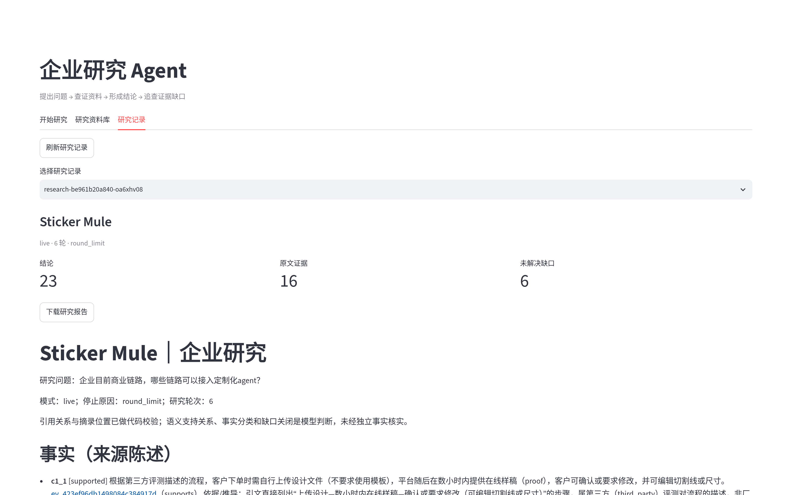
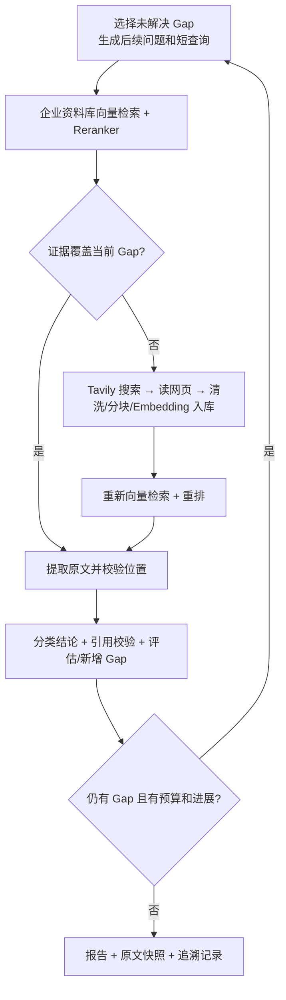
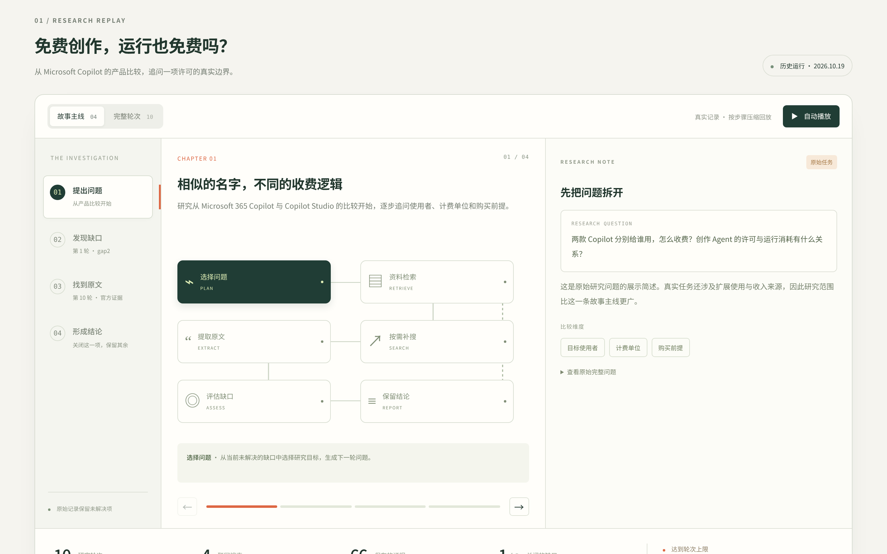

# 企业研究 Agent V2

Python / LangGraph / DeepSeek API / Tavily / 阿里云 Embedding 与 Reranker / RAG / Pydantic。

V2 是独立项目，V1 保持原样。DeepSeek、Tavily、受限网页读取适配器及相应回归测试来自 V1；研究图、持久资料库、阿里云适配器、领域契约、报告和界面在 V2 实现。

## 快速开始

不需要 API 密钥，先看界面和一次完整的合成演示（Python 3.10+）：

```bash
python3 -m venv .venv
.venv/bin/python -m pip install -e '.[ui]'
./start_ui.sh
```

浏览器访问终端显示的本机地址，在“开始研究”页点击 **运行离线合成演示**。也可以只用命令行：

```bash
.venv/bin/python -m enterprise_agent.cli demo
```

演示使用确定性测试替身，不联网、不调用模型；真实研究需要下一步的 API 配置。界面包含开始研究、研究预算、资料导入、进展、停止、历史记录和报告下载，默认绑定 `127.0.0.1`。

Windows 使用 `.venv\Scripts\python.exe`，安装后运行 `start_ui.cmd`。

安装测试依赖，或复现本次验收的依赖版本：

```bash
.venv/bin/python -m pip install -e '.[dev,ui]'
# 或：
.venv/bin/python -m pip install -r requirements.lock
.venv/bin/python -m pip install --no-deps -e .
```



更多截图：[工作台](docs/screenshots/workspace.png) · [运行中](docs/screenshots/demo-running.png) · [研究过程回放](docs/screenshots/research-replay.png)。

## API 配置

编辑本目录 `.env`；代码自动读取它，进程中已有的同名环境变量优先。修改已加载的配置后，重启界面进程。不要将密钥提交到版本库。

```dotenv
DEEPSEEK_API_KEY=你的DeepSeek密钥
TAVILY_API_KEY=你的Tavily密钥
DASHSCOPE_API_KEY=你的阿里云百炼密钥
DASHSCOPE_WORKSPACE_ID=你的业务空间ID
DASHSCOPE_REGION=cn-beijing
DEEPSEEK_MODEL=deepseek-flash
EMBEDDING_MODEL=text-embedding-v4
EMBEDDING_DIMENSIONS=1024
RERANKER_MODEL=qwen3-rerank
RAG_BACKEND=dashscope
```

阿里云采用业务空间专属域名及 **DashScope 原生 HTTP 协议**：

```text
https://{WorkspaceId}.{Region}.maas.aliyuncs.com/api/v1
  /services/embeddings/text-embedding/text-embedding
  /services/rerank/text-rerank/text-rerank
```

也可将控制台给出的、以 `/api/v1` 结尾的原生接口 Base URL 填入 `DASHSCOPE_BASE_URL`，此时优先使用它。不要把 OpenAI 兼容模式的 `/compatible-mode/v1` 地址填到这里。API Key、业务空间、地域应匹配。

Embedding 每批最多 10 段，区分 `query` 与 `document`；按返回 `text_index` 恢复输入顺序。Reranker 按 `index` 映射回候选资料，校验数量、重复索引和有限数值。两个 API 的实际 Token 用量单独记录，不混入 DeepSeek 用量。

官方接口依据：[Embedding](https://help.aliyun.com/zh/model-studio/text-embedding-synchronous-api)、[Reranker](https://help.aliyun.com/zh/model-studio/text-rerank-api)、[API Key](https://help.aliyun.com/zh/model-studio/get-api-key)、[DeepSeek JSON](https://api-docs.deepseek.com/guides/json_mode/)、[Tavily Search](https://docs.tavily.com/documentation/api-reference/endpoint/search)。

```bash
.venv/bin/python -m enterprise_agent.cli doctor
```

`doctor` 只显示配置是否存在，不输出密钥，也不把“已填写”当作联网成功。

## 命令行

```bash
# 导入已有材料；企业名称须与后续研究一致
.venv/bin/python -m enterprise_agent.cli ingest --company '目标企业' ./已有研究.md ./资料.txt

# 真实研究
.venv/bin/python -m enterprise_agent.cli research \
  --company '目标企业' --goal '企业如何收费？客户为什么付费？有哪些直接证据与未解决前提？'

# 用已知网页作为初始资料，后续仍然可以按缺口搜索
.venv/bin/python -m enterprise_agent.cli research \
  --company '目标企业' --goal '解释收入模式及其证据边界' \
  --source-url 'https://example.com/company'

# 更深入的工程试验预算；不是质量承诺或金额上限
.venv/bin/python -m enterprise_agent.cli research \
  --company '目标企业' --goal '比较各产品的客户、收费与交付方式，辨别商业判断和未知项' \
  --max-rounds 10 --max-searches 12 --max-pages 40 --max-model-calls 64 \
  --max-embedding-calls 300 --max-reranker-calls 30 --gap-attempts 2 --timeout 2400

# 可复现的预算预设；显式 --max-* 仍优先
.venv/bin/python -m enterprise_agent.cli research \
  --company '目标企业' --goal '问题' --preset deep

# 两家企业比较：第二家企业名用于识别其官方域名并复用其资料分区
.venv/bin/python -m enterprise_agent.cli research \
  --company 'Fathom' --company-alias 'Plausible' \
  --goal 'Fathom vs Plausible 的竞争壁垒是否可持续？'

# 离线合成演示，不使用密钥、不联网
.venv/bin/python -m enterprise_agent.cli demo
```

默认预算为 6 轮、8 次搜索、24 次网页读取、36 次 DeepSeek 调用、160 次 Embedding 调用、18 次 Reranker 调用、20 分钟。向量召回 40 段后重排保留 10 段。CLI `--help` 与中文界面均可调整预算。一次研究的所有轮次共用同一预算，尝试失败也占用调用次数。没有强制用满预算；未解决缺口保留为 `open`。

`--preset easy|standard|deep` 分别设置 6/8/10 轮、6/8/10 次搜索、12/16/20 次网页、36/48/64 次模型调用、300/500/700 次 Embedding、12/16/20 次 Reranker、1200/1800/2400 秒超时；显式参数优先。预设只设置资源上限，不改变任何质量校验。20 题评测使用这些预设以便复核。

`--gap-attempts`（默认 2）限制同一缺口连续占用的轮次；达到上限后，只要还有其他未尝试缺口，规划器必须先处理其他缺口。这不是质量承诺，而是防止一个 PDF 缺口吞掉全部轮次。新缺口还必须提供稳定的 `topic`；同一资料/同一组条款被换个措辞重述时，代码会按 topic 或文本相似度合并，并把新结论并入原缺口，避免每轮新增一个同义 gap。

无效结构或引用可在同一步骤内校正一次，全任务默认最多 4 次校正（`--max-recovery-calls`）。校正同时消耗总模型调用额度，不刷新预算、不重新搜索，也不提交失败尝试中的状态。原文匹配要求不会因重试降低。若一批摘录中只有部分逐字匹配，未匹配项被记录并丢弃，合法摘录仍会进入证据链；若没有任何摘录逐字匹配，则进入校正/失败路径。拒绝的摘录及对应原文片段会写入追溯记录，便于排查。

规划器还会检查比较型目标的两侧覆盖量：若一方的问题/证据/结论总量不足另一方的一半，且已有开放缺口指向落后一方，而本轮计划仍未涉及该对象，会先用一次校正要求规划器改查落后一方；再次违反时记录 `plan_guard_overridden` 并继续，避免为守规则而丢掉已有成果。

这些数值尚未经过研究质量/成本校准。每轮当前至多生成一个新搜索任务，因此增加搜索上限时也要考虑轮次。冷启动网页资料库的 Embedding 消耗与页长有关；后续运行复用已入库材料。资料导入是独立操作，不计入某次研究预算。

## 真正的循环结构



`engine.py` 使用 `StateGraph`、条件边和回边执行上述图，不是在一个 LangGraph 节点中隐藏固定单次搜索。规划器收到已有结论、未解决缺口、历史查询、上一轮覆盖判断、搜索来源标题和摘录结果，以此调整后续任务。[LangGraph Graph API](https://docs.langchain.com/oss/python/langgraph/graph-api)



*研究过程回放（showcase 静态页）：章节、研究图与原始问题。*

## 资料库与证据链

- 来源权威除已知厂商域名规则外，也会按企业名与注册域名作匹配启发式；这不是对域名所有权的独立验证。
- 业务流程/Agent 接入类问题先调查交易或服务的端到端步骤，再评估角色、触发条件、输入输出、系统接口、人工交接和候选接入点。招聘广告或“没找到 Agent 公告”不能代替业务流程分析；公开资料无法说明内部流程时，结论须保留为待核实假设。
- 网页：读取公开 HTML/纯文本以及文本型 PDF，清洗后切为带重叠和字符偏移的片段。HTML 标题以 `§标题§` 标记保留；PDF 文本带 `§PDF page N§` 页标记，便于定位与理解上下文。搜索摘要只用于发现网页，不能作为正文证据。网页读取继承 V1 的凭据隔离、逐跳地址检查、时间与大小限制。扫描件/图片型 PDF 不做 OCR，会返回明确错误而不是编造正文。
  - 默认单页上限为 8 MB / 400,000 字符。10-K/10-Q 的财务报表通常在后半段，旧的 1 MB / 60,000 字符限制会让它们被误判为读取失败或截断丢失；现在默认保留足够正文，长文件在报告中明确标记截断。
  - SEC 公平访问要求带联系信息的 User-Agent。默认 UA 为 `BusinessAgentResearch/0.2 (+https://localhost/business-agent)`；可用 `WEB_READER_USER_AGENT` 替换。SEC 申报单独标为 `regulator_filing`（监管申报），既不当成厂商产品页，也不当成第三方评论。
  - 遇到 403/429、超时、超大页面或反自动化拦截页时，可在 `.env` 设置 `WEB_READER_MIRROR=https://r.jina.ai` 启用文本镜像回退。镜像只读取公开页面，不携带任何密钥；报告的来源仍记录原始 URL，并在 `location` 中注明“text mirror”及直接读取失败原因。该功能默认关闭，因为启用后请求 URL 会发送给第三方文本渲染服务。
  - 返回 HTTP 200 但正文是 “Your request has been blocked” 等拦截页时，读取器返回 `blocked_page`，不会把拦截页当作官方证据入库。
- 既有资料：支持 UTF-8 `.md`、`.txt`、`.html`、`.htm`，每份最多 2 MB。可以导入 V1 的 Markdown 报告，但会标记为二手研究材料，不伪称重新核验了其引用网页。本地 PDF 尚未纳入导入命令；网页 PDF 由读取器直接提取。
- 持久化：SQLite 保存原文快照、分块、模型标识及向量；NumPy 做精确余弦检索，再调用 `qwen3-rerank` 二次排序。按企业名称分区，修改 Embedding 模型/维度需要换数据库并重新导入。默认库为 `data/knowledge.sqlite3`，可用 `--db` 指定。
- 来源权威：每个来源标记 `vendor_official`（厂商正式文档/定价/许可页）、`regulator_filing`（SEC 等监管申报）、`vendor_community`（厂商域名托管的用户问答/社区回帖）、`third_party`、`research_material` 或 `demo`。`learn.microsoft.com/answers` 是社区内容而非正式许可文档；要求官方/正式条款/PDF 的缺口不能仅凭社区或第三方证据关闭，但 SEC 等监管申报可作为财务披露的一手来源。要求官方产品条款的缺口仍以厂商正式页面为准；要求 PDF 的缺口必须有实际提取的 PDF 文本或明确标注的 PDF 文本镜像。要求官方来源的检索是“优先保留官方证据并混入可读的第三方证据”，不再把第三方证据全部过滤掉；缺口关闭仍由代码检查官方/监管来源。
- 分类：`fact` 是来源直接陈述，`deduction` 是推导，`business_judgment` 是商业判断，`hypothesis` 是待验证假设。假设不得被标记为已支持或用于关闭缺口。价格/许可只支持定价与许可事实，不自动等同已实现收入或利润。后续轮次可以引用此前已校验的 evidence，但不得引用不存在的 ID。
- 结论状态归一：模型若把只有反证的结论标为 `supported`，解析层会按引用改为 `contradicted` 或 `mixed`；无引用的 `fact` 降为 `unverified` 的 `hypothesis`；`hypothesis` 强制保持 `unverified`。这只修正标签与引用的一致性，不改变或放宽逐字引用校验，并写入 `claim_normalized` 追溯事件。
- 数量审计：若结论文本中的金额、百分比或千分位数字没有出现在它所引用的任何逐字摘录中，写入 `claim_number_not_in_citation` 事件。该信号不拒绝结论，因为数字可能来自同一来源的其他段落；它把“引用真实但数字未被该摘录覆盖”的情况显式留给人工复核。
- 引用：Claim 的每条 Citation 标明支持或反驳的 Evidence；Evidence 指向 Question、Chunk、Source；Source 带网页 URL、时间、清洗文本哈希和 acquisition；后者记录获取时的运行、问题、搜索词和搜索记录 ID。
- 校验：来源哈希、分块范围、逐字摘录、全局 ID 唯一性、引用存在性、支持/反驳状态及缺口关闭引用均由 Pydantic 检查。模型不能自行指定网页元信息或篡改来源。已接受证据在综合前单独保存，后续失败不会抹去它们。

## 产物

每次运行新建独立目录，不覆盖已有研究：

| 文件 | 内容 |
| --- | --- |
| `report.md` | 结论摘要（模型从已校验 Claim 中选出）、四类结论、证据引用、未解决缺口、问题与搜索历史、原文摘录和定位 |
| `state.json` | 可再次通过 Pydantic 校验的完整状态，以及清洗后的来源文本快照 |
| `trace.jsonl` | 节点、规划、覆盖判断、排序分数、调用用量、状态变更和安全错误信息 |
| `result.json` | 模式、停止原因、轮次、产出数量、实际调用和预算 |

`examples/api-validation.json` 保留了两个阿里云模型的小规模真实接口验收；`examples/live/` 保存真实研究验收报告、`result.json` 与失败记录；真实运行的原始 `state.json`/`trace.jsonl` 含来源网页正文，默认不入库。合成演示明确标记 `demo`，使用确定性测试替身验证编排，不冒充真实语义 Embedding 或真实 DeepSeek 结果。

## 验证结果（2026-10-20 基准）

在 20 个研究问题上完成 29 次结构化运行，其中 13 次为完整运行（有 answer 且写入 `run_end`）：

| 指标 | 全部 29 次 | 13 次完整运行 |
| --- | ---: | ---: |
| 参与校验的原文引文 | 495 条 | 286 条 |
| 逐字回查通过 | 446 条（90.1%） | 264 条（92.3%） |
| 单次运行平均通过率 | 88.6% | 90.5% |
| 平均耗时 | 282 秒 | 366 秒 |
| 平均 Token | 25.2 万 | 31.5 万 |

- “逐字回查通过”只表示引文能在来源原文中按字符范围找到，不证明该引文在语义上足以支持结论。
- 29 次运行的整体成功率为 44.8%；其余运行因预算耗尽、结构化输出校验失败或主动取消而停止，未计入完整运行的质量指标。
- 明细见 `verification/enterprise-research-20q-2026-10-20/quote_summary.md`、`scorecard.md` 与 `scorecard.json`，统计脚本为 `score_runs.py`。真实运行的原始 `state.json`/`trace.jsonl` 含来源网页正文，未随仓库发布，因此可复核统计口径，但无法从原始记录重算。

## 验证与边界

```bash
env -u PYTHONPATH .venv/bin/python -m pytest -q -p no:cacheprovider
```

如果环境中注入了其他 pytest 插件，上面的命令只为当前子进程清除 `PYTHONPATH`，不改系统配置；没有该影响时可直接运行 `.venv/bin/python -m pytest`。

测试覆盖真实 LangGraph 多轮路由、资料充足时跳过外部搜索、缺口补搜、跨企业隔离、API 响应映射、伪造引用拒绝、预算/取消/错误时成果保留，以及中文界面的离线流程。质量守卫另有离线测试：PDF 正文提取与页标记、来源权威分级、摘录上下文、部分无效摘录的丢弃、同义重复缺口合并、缺口尝试上限、比较目标覆盖平衡、SIGTERM 下写入终态报告。联网验收与纯离线测试分开记录。

代码能验证引用和原文一致，不能证明网页本身真实，也不能证明一段摘录在语义上充分支持结论。资料充足性、结论类型、证据支持关系和缺口关闭均属于模型评估。已关闭缺口仍需要人工复核；`no_open_gaps` 不是“全部事实已证实”。

SQLite 精确向量扫描适合个人及小型研究资料库，没有声称具备大规模 ANN 索引能力。当前未提供跨进程续跑、OCR、登录网页采集或独立语义事实核验。文本型 PDF 已支持，扫描件仍需 OCR。进程取消（界面“停止”、Ctrl-C 或 SIGTERM）会保存既有结果并写入 `result.json`/`report.md`，停止原因记为 `cancelled`；CLI 收到 SIGTERM/SIGINT 时分别以 143/130 退出，便于调用方区分中断与普通失败。已在执行的同步检索 HTTP 请求可能到自身超时才结束，但后续批次不会继续发起。CLI 错误或超时退出非零，不能把零结论记录描述为成功研究。

主要代码：`engine.py`（研究图）、`schema.py`（状态与契约）、`rag.py`（资料库）、`providers/dashscope.py`（阿里云）、`artifacts.py`（报告/追溯）、`ui.py`（中文工作台）。
